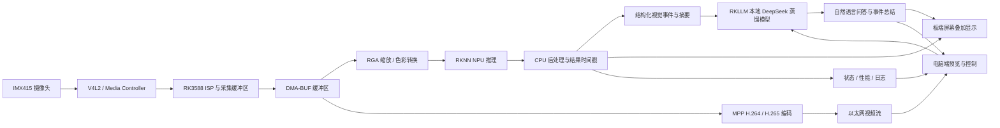

# 基于 RK3588 的边缘 AI 视觉与本地大模型分析终端

**项目范围与总体方案**  
文档版本：v1.1  
状态：开发基线草案  
适用平台：RK3588 单板主平台；电脑作为可选监控与管理端

## 1. 项目定位

本项目以 RK3588 为唯一嵌入式计算主平台，完成一条可测量、可复现的边缘 AI 链路：摄像头采集、实时视觉推理、本地 DeepSeek 蒸馏模型问答、视频编码、本地显示、电脑端查看和运行数据记录。视觉模型使用 RKNN；本地语言模型使用 RKLLM，两者是不同的模型格式、工具链和运行时。

“发挥 RK3588 能力”在本项目中的含义，是把 CPU、ISP、RGA、NPU、视频编解码器、显示和网络组成一条稳定的异构处理流程，并分别测量每一级的吞吐、延迟、资源占用和温度。项目不以让所有单元持续满载为目标，也不把芯片宣传峰值直接当成应用性能。

## 2. 已知条件、假设和待确认项

### 已知条件

- 用户已有 RK3588 开发板，曾说明配置为 4GB 内存、32GB eMMC。
- 用户有 IMX415 摄像头、显示屏和电脑。
- 项目希望以实际开发和学习为主，自己实现应用、测试工具和项目层代码。

### 当前假设

- RK3588 板卡可能为 正点原子 ATK-DLRK3588B 系列，具体核心板、底板和硬件版本仍需按实物铭牌确认。
- 摄像头为正点原子配套 IMX415 模块，或电气接口和驱动兼容的模块。
- 电脑端承担远程预览、参数配置、状态展示和日志管理，不参与板端实时控制闭环。
- 正点原子公开教程给出的 ATK-DLRK3588 4GB 配置目标为 DeepSeek-R1 1.5B；是否适用于手头具体板卡与镜像仍需核实，不能据此推定视觉链路并发时一定够用。

### 开始硬件开发前必须确认

1. 核心板和底板的准确型号、PCB 版本、内存和存储规格。
2. IMX415 模块的准确型号、排线方向、连接器位置和可用 CSI 通道。
3. 屏幕接口类型、分辨率和当前系统是否已经点亮。
4. 当前启动镜像、Linux 发行版、内核版本、厂商 SDK 版本和交叉编译工具链。
5. 当前系统中 ISP、V4L2、RGA、RKNPU、MPP、DRM/KMS、RKLLM Runtime 的驱动和用户态库是否匹配。

这些信息会影响相机设备树、传感器驱动、缓冲区格式和硬件加速接口。不能仅凭 SoC 型号推定板卡已经启用了某个接口或软件组件。

## 3. 项目目标

### 必须完成

- 采集一路 IMX415 视频，并记录实际协商到的分辨率、像素格式和帧率。
- 使用 V4L2 和 Media Controller 相关接口检查视频链路，说明传感器、CSI、ISP 和视频节点之间的关系。
- 实现可重复运行的采集诊断程序，记录帧数、丢帧、错误、帧间隔和运行时长。
- 实现一条经过 RGA 处理并由 RKNN NPU 推理的视觉流程，至少完成一种目标检测或分类任务。
- 部署一种 RKLLM 支持的本地 DeepSeek-R1-Distill 模型，在第一版中以 DeepSeek-R1-Distill-Qwen-1.5B 作为 4GB 板卡的候选目标；具体模型、量化和运行能力以当前板卡镜像及实测为准。
- 在板端屏幕上显示实时画面、推理结果和运行状态。
- 提供电脑端监控程序或工具，用于看视频、查看指标、通过自然语言查询视觉事件、修改允许远程调整的参数和保存日志。
- 形成版本清单、测试记录、性能报告、部署说明和问题排查步骤。

### 学习目标

- 理解 V4L2、Media Controller、设备树、DMA-BUF、RGA、RKNN、RKLLM、MPP 和 DRM/KMS 在真实链路中的职责。
- 先建立 CPU 或厂商参考路径的基线，再逐项引入硬件加速并比较结果。
- 对每种优化记录测量方法和条件，不以单次 FPS 数字代替完整性能分析。

## 4. 第一版不包含

- 不使用 i.MX6ULL、STM32F407、STM32F103 组成多板控制网络。
- 不实现电机控制、移动机器人导航或安全认证控制。
- 不训练或微调大型模型；第一版部署经过蒸馏、量化并能由当前 RKLLM Runtime 运行的 DeepSeek 模型。视觉检测仍使用适合 RKNN 的模型。第一版不以运行 DeepSeek 原始全尺寸模型为目标。
- 不从零编写 RK3588 的 ISP、MIPI CSI、NPU、视频编码器或显示控制器驱动。
- 不默认承诺零拷贝、4K 实时推理、指定检测精度或固定 FPS；这些必须由板卡、模型和测试条件验证。

## 5. 总体数据流



图中的 DMA-BUF 是跨设备共享缓冲区的候选机制，不代表自动实现零拷贝。实际能否共享取决于采集、RGA、NPU、MPP 和显示路径支持的缓冲区分配方式、像素格式、步幅、同步机制和驱动版本。第一版应先做通，再用测量确认是否减少了复制和延迟。

DeepSeek 路径是低频、异步的交互和事件解释模块，不进入逐帧实时检测的关键路径。RKNN 负责实时视觉模型；RKLLM 负责本地语言模型。第一阶段先验证两者分别运行，再评估相机、RGA、MPP、显示和 RKLLM 同时工作时的内存与 NPU 资源竞争。若 4GB 内存不足，允许将 LLM 改为按需启动或暂时停用视觉推理后的交互模式。

## 6. 模块职责

| 模块 | 运行位置 | 职责 | 第一版验收重点 |
|---|---|---|---|
| 摄像头采集 | RK3588 | V4L2/Media Controller 采集、格式协商、错误恢复 | 稳定采集并输出可追踪统计 |
| 图像处理 | RK3588 | RGA 缩放、裁剪或格式转换 | 与 CPU 处理结果比较，测量时间和 CPU 占用 |
| AI 推理 | RK3588 | RKNN Runtime 加载视觉模型、推理、后处理 | 输出正确结果并记录端到端延迟 |
| 本地大模型 | RK3588 | RKLLM Runtime 运行 DeepSeek 蒸馏模型，回答关于视觉事件和设备状态的问题 | 单独与并发运行时的内存、首 token 延迟和 token/s 有记录 |
| 本地界面 | RK3588 | 画面、检测框、帧率、设备状态 | 与采集链路同时运行，不明显阻塞处理线程 |
| 电脑端 | PC | 视频预览、指标、配置、日志 | 断线可恢复，远程命令有校验和状态回报 |
| 诊断工具 | RK3588/PC | 环境信息、性能采样、日志打包 | 每次测试能够复现相同测量口径 |

## 7. 自主开发与厂商组件边界

### 项目自己编写

- 采集诊断和 V4L2/Media Controller 实验程序。
- 图像处理、RKNN 视觉推理、RKLLM 对话集成、结构化视觉事件、业务逻辑、结果后处理和性能统计。
- 板端 UI、电脑端应用、设备间协议、日志和部署脚本。
- 自己维护的设备树覆盖文件、内核补丁和驱动实验代码；每项修改都记录适用内核版本和回退方法。
- 测试场景、验收记录、性能基线和问题复现材料。

### 使用厂商或上游提供的基础能力

- RK3588 的 ISP、MIPI CSI、RKNPU、视频编码/解码、RGA、显示控制器等 SoC 级驱动和硬件抽象。
- 与当前厂商 BSP 匹配的 RKNN Runtime、RKLLM Runtime、RGA 用户态库、MPP、显示栈及交叉工具链。RKLLM 官方工具链负责模型转换，板端 Runtime 负责推理。
- 第一阶段优先使用厂商镜像和参考程序，先确认硬件工作，再逐步替换项目自己的用户态模块。

如果 IMX415 当前镜像没有可用驱动，可以把“传感器 I2C/V4L2 子设备驱动”作为单独学习阶段：先确认传感器数据手册、供电、时钟、复位、I2C 地址和 CSI lane 配置，再从最小读写与模式切换验证开始。不要把改写 SoC ISP/CSI/NPU 驱动作为第一版任务。

厂商 BSP、SDK、内核源码和闭源二进制库作为外部依赖记录版本、来源、许可和校验值；不要把完整 SDK 或大体积供应商源码直接复制进项目仓库。项目自有补丁和配置单独保存。

## 8. 性能指标与测量口径

每次性能记录至少包含：

- 板卡型号、内存、镜像、内核、驱动和用户态运行库版本。
- 摄像头模式、分辨率、像素格式、实际帧率和曝光设置。
- 视觉模型文件版本、输入尺寸、量化类型、NPU 配置和预处理方式。
- 每阶段延迟：采集、预处理、NPU、后处理、显示/编码；报告平均值和 P50/P95。
- 帧数、丢帧、错误、编码码率、网络端到端延迟、CPU/内存占用、频率和温度。
- 测试持续时间、散热条件、供电方式和复现实验步骤。

项目目标应在硬件基线阶段根据实际镜像、摄像头模式、模型和散热条件冻结。未经重复测试的数据只能标为观察值，不能作为性能承诺。

## 9. 版本和依赖管理

在 docs/boards/rk3588/ 中维护板卡基线表，至少锁定：

- 板卡和摄像头硬件版本。
- 系统镜像版本、内核版本、设备树版本和厂商 SDK 发布包。
- RKNN Runtime、RKLLM Runtime、RKLLM Toolkit 与 NPU 驱动版本。
- MPP、RGA、Qt/显示栈版本。
- 主机交叉编译器和构建工具版本。
- 相关下载地址、许可证、文件哈希和本地保存位置。

升级任一关键依赖时，先建立升级分支并运行对应回归验收，不在稳定基线上直接替换未知版本。

## 10. 建议仓库位置

```text
docs/
├── project/
│   └── RK3588_Edge_AI_Vision_Project_Scope_v1.1.md
├── architecture/
│   └── decisions/
├── development/
│   └── RK3588_Edge_AI_Vision_Development_Plan_v1.1.md
└── boards/
    └── rk3588/
        └── RK3588_Board_Baseline_Template_v1.1.md

software/
├── linux/rk3588/
│   ├── apps/{camera,vision,llm,streaming,ui,diagnostics}/
│   ├── device-tree/overlays/
│   ├── drivers/media/i2c/imx415/
│   ├── kernel/patches/
│   └── tests/
└── host/
    ├── app/
    ├── tools/
    └── tests/

common/protocol/
hardware/{bom,wiring,schematics}/
external/
tests/{acceptance,integration}/
tools/{capture,deploy,scripts}/
```

现有仓库中 i.MX6ULL 和 STM32 的空目录不需要在新项目第一阶段继续开发。因为它们可能属于此前的多板方案，建议先保留并在项目范围文档中说明当前主线只实现 RK3588；确认旧内容不再需要后，再用独立提交清理，避免误删已有资料。

## 11. 主要风险

| 风险 | 影响 | 应对方法 |
|---|---|---|
| 板卡、镜像和 SDK 版本不匹配 | 摄像头、RGA、NPU 或 MPP 示例无法运行 | 先记录基线，使用同一厂商 SDK 的配套库和驱动 |
| IMX415 模组接口或设备树不匹配 | 无图像或传感器无法探测 | 核对实际模块、CSI 接口、排线方向、供电和设备树 |
| 缓冲区格式或同步不兼容 | 共享缓冲失败、花屏、画面撕裂 | 先使用可工作的复制路径，逐段验证共享和 fence/同步 |
| 4GB 内存和温度约束 | DeepSeek 模型与视觉缓冲、编码和 UI 并发时可能内存紧张或降频 | 先单独运行，再测并发；内存不足时采用 LLM 按需启动或分时运行 |
| 过早追求“全硬件加速” | 调试复杂度大，问题难以定位 | 先 CPU 基线，再一次引入一个硬件模块 |
| 模型转换兼容性或精度下降 | 模型可运行但视觉结果或语言输出质量不符合预期 | 视觉模型与 LLM 分别验证；记录模型来源、量化参数和测试集 |

## 12. 官方参考资料

- 正点原子 ATK-CLRK3588B 核心板简介与 4GB+32GB 配置：[核心板简介](https://wiki.alientek.com/docs/Boards/Linux/DLRK3588/DLRK3588%20%E6%A0%B8%E5%BF%83%E6%9D%BF%E8%A7%84%E6%A0%BC%E4%B9%A6/core/core/)
- 正点原子板卡 MIPI 摄像头说明及 IMX415 配套信息：[摄像头测试](https://wiki.alientek.com/docs/Boards/Linux/DLRK3588/DLRK3588%20%E5%BF%AB%E9%80%9F%E4%BD%93%E9%AA%8C%E6%89%8B%E5%86%8C/function_test/3.8_camera/)
- Rockchip RKNN Toolkit2（视觉模型转换与 RK3588 支持）：[官方仓库](https://github.com/airockchip/rknn-toolkit2)
- Rockchip MPP（媒体编解码用户态接口及依赖说明）：[中文开发指南](https://github.com/rockchip-linux/mpp/blob/develop/doc/Rockchip_Developer_Guide_MPP_CN.md)
- Linux V4L2 采集接口：[Video Capture Interface](https://docs.kernel.org/userspace-api/media/v4l/dev-capture.html)
- Linux Media Controller：[Media Controller API](https://docs.kernel.org/userspace-api/media/mediactl/media-controller.html)
- Linux DMA-BUF 缓冲区共享和同步：[DMA-BUF documentation](https://docs.kernel.org/driver-api/dma-buf.html)

厂商在线资料可能随 SDK 版本更新。实施时应以自己板卡随附的 SDK、内核和镜像文档为准，并在仓库中记录实际使用版本。


